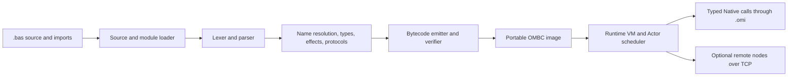

# Architecture overview

OMBasic is a statically typed, BASIC-style language. Functions use inferred
types and explicit effects. Mutable state and asynchronous work belong to
Actors, which communicate through typed Messages.

## Compilation and runtime



The source loader establishes canonical module identities, validates import
paths, and orders modules before compilation. The lexer and parser report
source-spanned errors and build a syntax-only AST. Name resolution, type
inference, effect analysis, Actor protocol checking, and serialization
validation operate on that AST and produce the semantic model consumed by the
bytecode emitter. The emitter builds and verifies an owned image; serialized
OMBC files contain explicit fixed-width fields rather than C structures.

The VM verifies bytecode before execution. Each Actor owns its mutable state,
VM stack, and heap. Mailbox messages are copied into owned transit storage and
then into the receiving Actor's heap. Scheduler workers never mutate another
running Actor's heap. Blocking Native and system I/O operations use a bounded
worker pool, and their results return through ordinary mailbox messages.

Native declarations live in `.omi` metadata. The FFI layer validates C ABI
signatures and ownership annotations, then uses libffi for calls. Foreign
thread callbacks copy supported scalar fields into a mailbox; they never run
Actor handlers on the foreign thread. Remote nodes exchange versioned frames,
typed payloads, and program/interface fingerprints. The current transport is
blocking TCP and does not retry failed sends or authenticate peers.

## Capabilities and dependency direction

The primary compilation path is:

```text
foundation -> source -> syntax -> module_graph -> semantic -> bytecode -> compiler -> CLI
```

The VM depends on bytecode and runtime contracts, not on compiler internals or
syntax. Tooling calls the public source, syntax, semantic, and compiler APIs.
The [dependency rules](dependency_rules.md) and architecture checker enforce
the allowed direction and private-header boundaries.

## Developer tooling

The `ombasic` executable provides `check`, `run`, `build`, `fmt`, `bind`,
`check-omi`, `lsp`, and `version`. `check`, `run`, and `build` share the same
compiler pipeline. The LSP server handles JSON-RPC framing and editor position
conversion, then asks the compiler executable for analysis results; it does
not implement another parser or type checker.

Detailed format and ABI contracts are maintained alongside their owning
capabilities: [OMBC](../../src/bytecode/README.md), [Native FFI](../../src/ffi/README.md),
and [distribution](../../src/distribution/README.md).
