# Architecture overview

OMBasic is a statically typed, BASIC-style language. Functions use inferred
types and explicit effects. Mutable state and asynchronous work belong to
Actors, which communicate through typed Messages.

## Native AOT compilation

```mermaid
flowchart LR
    Source[".bas source and imports"] --> Frontend["Source, lexer, parser"]
    Frontend --> Semantic["Names, types, effects, protocols"]
    Semantic --> HIR["Typed HIR"]
    HIR --> Specialize["Generic specialization"]
    Specialize --> MIR["Native MIR / CFG"]
    MIR --> Target["Target ABI model"]
    Target --> LLVM["LLVM C API backend"]
    LLVM --> Compiler["Compiler pipeline"]
    Compiler --> Object[".o / .obj"]
    Object --> Linker["Linker module: LLD / platform linker"]
    Linker --> Executable["Native executable"]
    Executable --> Runtime["libombasic_runtime via Runtime ABI"]
```

The frontend and semantic analysis own OMBasic language meaning. HIR records
resolved symbols, concrete types, effects, protocol identities, and source
spans. Specialization makes native function instances concrete. MIR expresses
values and control-flow blocks, not stack-machine instructions. The LLVM
backend lowers MIR mechanically and emits object files; it does not implement
language semantics.

Generated native code calls a stable Runtime ABI. Runtime owns managed objects,
shadow roots, Actor state, mailboxes, scheduling, system services, callbacks,
and distribution. It does not parse source, inspect compiler IR, interpret
instructions, or depend on LLVM.

## Implementation state

The VM and OMBC execution path have been removed. The compiler now lowers
source through typed HIR, specialization, verified MIR, and LLVM object
emission; `build` and `run` link standalone native executables. Runtime
capabilities include managed heaps, Actors, system services, Native calls and
callback ingress, and distributed Actor messaging.

## Capabilities

See [dependency rules](dependency_rules.md), the
[Runtime ABI](../runtime/runtime_abi.md), and the [HIR](../compiler/hir.md)
and [MIR](../compiler/mir.md) contracts. The phase-by-phase gate is tracked in
[implementation status](../development/implementation_status.md).
